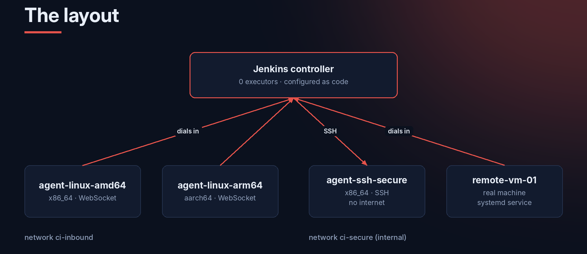

Last project from my CodeAlpha DevOps internship. The task was to set up Jenkins Remoting, which is how Jenkins runs builds on other machines (agents), spread the work across them, run jobs on different CPU architectures, and use node isolation for security.

**Repo:** [github.com/mikegbenga/CodeAlpha_JenkinsRemoting](https://github.com/mikegbenga/CodeAlpha_JenkinsRemoting)

## The idea

The main Jenkins server (the **controller**) never runs a build itself. Everything goes to agents. If a build runs on the controller, it can read everything in `JENKINS_HOME`, including every credential, so keeping builds off it is one of the easiest security wins.



| Agent | How it connects | CPU | Network |
|---|---|---|---|
| `agent-linux-amd64` | Agent dials in over WebSocket | x86_64 | `ci-inbound` |
| `agent-linux-arm64` | Agent dials in over WebSocket | aarch64 | `ci-inbound` |
| `agent-ssh-secure` | Controller connects over SSH | x86_64 | `ci-secure` (no internet) |
| `remote-vm-01` | Real machine, dials in over WebSocket | any | anywhere it can reach the controller |

## How Jenkins Remoting works (short version)

Remoting is the library behind the controller–agent connection. It opens a two-way channel, over WebSocket, TCP or an SSH session. Over that channel the controller sends the agent bits of work to run (`sh`, `checkout`, file operations), the agent streams the console output and files back, and the agent downloads any Java classes it needs from the controller.

The agent side is `agent.jar`. It has to match the controller's version, so the installer always downloads it from `<JENKINS_URL>/jnlpJars/agent.jar`.

For agents that dial in (inbound agents):

1. The node is defined on the controller, and Jenkins generates a **secret** for it.
2. The agent starts with `-url`, `-name`, `-secret` and `-webSocket`.
3. It connects to the controller's normal web port, and the controller checks the secret.
4. The node goes online. If the connection drops, the agent reconnects by itself.

The nice thing about WebSocket is that the agent only needs to reach the controller's web port. The agent machine doesn't need any open ports, so it works fine behind NAT.

## Everything is configured as code

I didn't click anything in the Jenkins UI. The controller image installs the plugins, and **Jenkins Configuration as Code (JCasC)** sets up security, nodes and credentials when it starts. The demo jobs are created by **Job DSL**.

```dockerfile
FROM jenkins/jenkins:lts-jdk17
ENV JAVA_OPTS="-Djenkins.install.runSetupWizard=false" \
    CASC_JENKINS_CONFIG=/usr/share/jenkins/casc
COPY plugins.txt /usr/share/jenkins/ref/plugins.txt
RUN jenkins-plugin-cli --plugin-file /usr/share/jenkins/ref/plugins.txt
COPY casc/      /usr/share/jenkins/casc/
COPY pipelines/ /usr/share/jenkins/pipelines/
```

The important parts of `casc/jenkins.yaml`:

```yaml
jenkins:
  numExecutors: 0          # the controller never builds
  mode: EXCLUSIVE
  remotingSecurity:
    enabled: true          # agents can't read or write controller files
  securityRealm:
    local:
      allowsSignup: false
      users:
        - id: "${JENKINS_ADMIN_ID}"
          password: "${JENKINS_ADMIN_PASSWORD}"
        - id: "${JENKINS_DEV_ID:-developer}"
          password: "${JENKINS_DEV_PASSWORD}"
  authorizationStrategy:
    globalMatrix:
      entries:
        - user:
            name: "${JENKINS_ADMIN_ID}"
            permissions: ["Overall/Administer"]
        - user:
            name: "${JENKINS_DEV_ID:-developer}"
            permissions: ["Overall/Read", "Job/Read", "Job/Build", "Job/Cancel"]

  nodes:
    - permanent:
        name: "agent-linux-arm64"
        labelString: "linux arm64 aarch64 inbound docker"
        remoteFS: "/home/jenkins/agent"
        mode: EXCLUSIVE    # only jobs that ask for these labels
        launcher:
          inbound:
            webSocket: true
    - permanent:
        name: "agent-ssh-secure"
        labelString: "linux amd64 ssh secure-zone"
        launcher:
          ssh:
            host: "agent-ssh"
            credentialsId: "agent-ssh-key"
            javaPath: "/opt/java/openjdk/bin/java"
            sshHostKeyVerificationStrategy:
              manuallyTrustedKeyVerificationStrategy:
                requireInitialManualTrust: false
```

And the SSH key the controller uses to start the SSH agent:

```yaml
credentials:
  system:
    domainCredentials:
      - credentials:
          - basicSSHUserPrivateKey:
              scope: SYSTEM        # Jenkins can use it, pipelines can't
              id: "agent-ssh-key"
              username: "jenkins"
              privateKeySource:
                directEntry:
                  privateKey: "${readFile:/run/secrets/agent_ssh_key}"
```

Things I had to figure out:

- The SSH agent image puts Java at `/opt/java/openjdk`, and an SSH session doesn't load the normal `PATH`. Without `javaPath` the agent fails with `java: not found`.
- The inbound agent secret can't be set in advance. Jenkins generates it from the node name and the controller's key, so the setup script reads it from the controller after Jenkins starts.

## Network isolation

```yaml
services:
  jenkins:
    networks: [ci-inbound, ci-secure]   # only the controller is on both

  agent-amd64:
    image: jenkins/inbound-agent:latest-jdk17
    cap_drop: [ALL]
    security_opt: [no-new-privileges:true]
    deploy:
      resources:
        limits: { cpus: "1.0", memory: 1g, pids: 512 }
    networks: [ci-inbound]

  agent-ssh:
    image: jenkins/ssh-agent:latest-jdk17
    networks: [ci-secure]

networks:
  ci-inbound:
    driver: bridge
  ci-secure:
    driver: bridge
    internal: true    # no route to the internet
```

Agents in different zones can't even resolve each other's names, and the secure zone has no internet access.

## Running on two CPU architectures

The arm64 agent is the same image with `platform: linux/arm64`. On an ARM machine (Apple Silicon, Raspberry Pi, AWS Graviton) it runs natively. On an x86 machine you enable emulation once:

```bash
docker run --privileged --rm tonistiigi/binfmt --install arm64
docker compose --profile arm64 up -d agent-arm64
```

Emulated builds are slower (roughly 5–10×), but it's enough to show the same job running on both.

## The demo jobs

Job DSL creates four pipelines in a folder:

### 01: Multi-architecture build

The same Java program gets compiled and run on three agents at once. Each one prints `os.arch`, so you can see where it actually ran. Then the results are gathered on one agent and archived.

```groovy
stage('Build on every architecture') {
    parallel {
        stage('x86_64 (inbound WebSocket)') {
            agent { label 'linux && amd64 && inbound' }
            steps { buildAndRun('amd64') }
        }
        stage('arm64 (inbound WebSocket)') {
            agent { label 'linux && arm64' }
            steps { buildAndRun('arm64') }
        }
        stage('x86_64 (SSH, secure zone)') {
            agent { label 'ssh && secure-zone' }
            steps { buildAndRun('amd64-ssh') }
        }
    }
}
```

`stash` and `unstash` move the built files between agents. That traffic goes through the Remoting channel too.

### 02: Load distribution

The job splits work into N shards (6 by default). Each shard asks for any agent with the `linux` label, and Jenkins spreads them across whatever's free. At the end it prints a table of which node ran which shard.

```groovy
for (int i = 1; i <= shards; i++) {
    def n = i
    branches["shard-${n}"] = {
        node(params.AGENT_LABEL) {
            sh "echo shard-${n} on \$NODE_NAME (\$(uname -m))"
        }
    }
}
parallel branches
```

### 03: Node isolation audit

This job runs on every agent and **fails** if something isn't isolated:

- The build runs as non-root
- The controller's `/var/jenkins_home` isn't visible
- The controller's SSH key isn't on the agent
- No effective Linux capabilities
- Agents in one zone can't resolve agents in the other zone

### 04: Remote machine build

This runs on `remote-vm-01`, a real machine outside Docker. It prints the host's OS, CPU, memory and Java version.

## Connecting a real remote machine

On the controller host, get the node's secret:

```bash
./scripts/fetch-agent-secrets.sh remote-vm-01
```

On the remote Linux machine:

```bash
sudo JENKINS_URL=http://<controller-ip>:8080 \
     AGENT_NAME=remote-vm-01 \
     AGENT_SECRET=<secret> \
     ./remote-node/install-agent.sh
```

The installer creates a `jenkins-agent` user with no login shell, downloads `agent.jar` from the controller, saves the secret in a file readable only by that user (`-secret @file`, so it never shows up in `ps`), and runs it as a locked-down systemd service:

```ini
[Service]
User=jenkins-agent
ExecStart=/usr/bin/java -jar /etc/jenkins-agent/agent.jar \
  -url ${JENKINS_URL} -name ${AGENT_NAME} \
  -secret @/etc/jenkins-agent/secret -workDir ${WORKDIR} -webSocket
Restart=always
NoNewPrivileges=true
ProtectSystem=strict
ProtectHome=true
ReadWritePaths=/var/lib/jenkins-agent
CapabilityBoundingSet=
MemoryMax=2G
```

There's also `install-agent.ps1` for Windows, which runs the agent as a scheduled task at startup.

## Running it

```bash
./scripts/setup.sh
```

The setup script:

1. Creates an SSH key pair and a `.env` with random passwords
2. Builds and starts the controller and the SSH agent
3. Waits for Jenkins to be healthy, then reads the inbound agent secrets
4. Starts the amd64 agent, and the arm64 one if emulation is available

Then `./scripts/status.sh` lists every node with its state, executors, architecture and labels.

## Security summary

| Control | Why |
|---|---|
| Controller has 0 executors | Builds can't read controller secrets |
| Agent → controller access control | A compromised agent can't touch controller files |
| Exclusive nodes + labels | Sensitive jobs only run in `secure-zone` |
| Separate networks, `ci-secure` has no internet | Zones can't reach each other |
| Non-root agents, `cap_drop: ALL`, resource limits | Limits damage from a bad build |
| Secrets from files, not the command line | Not visible in `ps` or logs |
| SYSTEM-scoped SSH key | Pipelines can't print it |
| Matrix authorization, no signup | `developer` can only read, build and cancel |
| Sandboxed pipeline scripts | Groovy runs under Script Security |

## Troubleshooting

| Problem | Fix |
|---|---|
| Inbound agent: `Incorrect secret` | The controller volume was reset; run `fetch-agent-secrets.sh` again |
| Agent tries `tcpSlaveAgentListener` | Set `JENKINS_WEB_SOCKET=true` |
| `Unknown launcher inbound` | Older Jenkins; rename `inbound:` to `jnlp:` |
| SSH agent: `Host key verification failed` | The container was recreated; trust the new host key |
| arm64: `exec format error` | Install binfmt (command above) |
| Job stuck "waiting for executor" | No online agent has that label; check `status.sh` |

## What I learned

- Keeping builds off the controller is easy and makes a big difference.
- WebSocket agents make connecting remote machines simple, even behind NAT.
- Labels are what make spreading the load practical.
- Having the whole setup in code means I can tear it down and rebuild it in a few minutes.

That's the end of this series. Thanks for reading, and thanks to [CodeAlpha](https://www.codealpha.tech) for the internship.
